<div align="center">

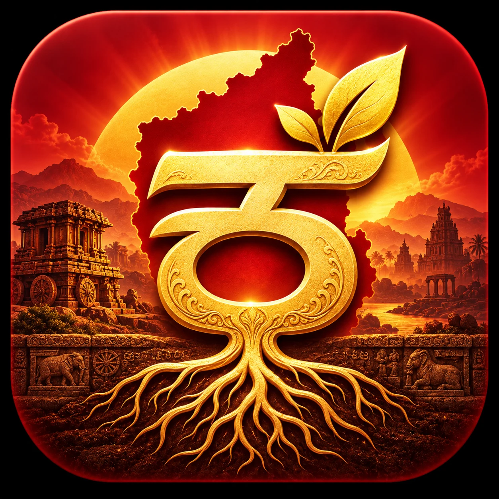

# ಕನ್ನಡದ ಬೇರು · Kannadada Beru

### ಪ್ರತಿಯೊಂದು ನುಡಿಗೂ ಕಥೆಯಿದೆ. ಪ್ರತಿಯೊಂದು ಕಥೆಗೂ ನೆಲವಿದೆ.

**Every expression has a story. Every story has a home.**

A Kannada-first, source-aware journey through Karnataka's words, places, voices, and memories.

[](https://kannadada-beru.vercel.app)
[](https://nextjs.org/)
[](https://react.dev/)
[](https://www.typescriptlang.org/)

[](https://kannadada-beru.vercel.app)
[](https://github.com/DSGAMING98/kannadada-beru/actions)
[](https://github.com/DSGAMING98/kannadada-beru/actions)
[](LICENSE)

**[Discover regional voices](https://kannadada-beru.vercel.app/voices)** · **[Explore Karnataka](https://kannadada-beru.vercel.app/explore)** · **[Search the dictionary](https://kannadada-beru.vercel.app/dictionary)** · **[Share your voice](https://kannadada-beru.vercel.app/contribute/audio)**

</div>

<p align="center">
  <a href="https://kannadada-beru.vercel.app">
    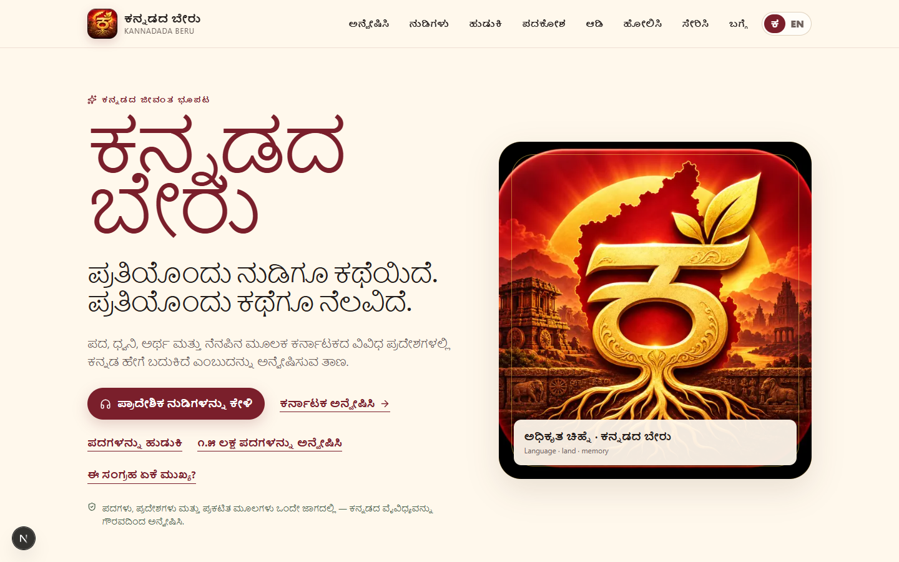
  </a>
</p>

<p align="center"><em>Language · land · memory — brought together with context and care.</em></p>

---

## 🌱 What is Kannadada Beru?

Kannada does not sound or feel exactly the same everywhere. Words shift across coastlines and plateaus, expressions carry local histories, and neighbouring languages enrich the way communities speak. Those stories are usually scattered across dictionaries, district references, research papers, recordings, and living memory.

**Kannadada Beru brings them into one beautiful, accessible experience.** Visitors can travel through all 31 Karnataka districts, discover the state's four broad language regions, search a large Kannada–English dictionary, hear permission-cleared human speech, compare documented regional usages, learn through play, and prepare their own contributions privately.

Built for **PS04 — Namma Kannada: Regional Language Explorer**, it is a complete public experience available on desktop and mobile. Its centrepiece, **ಒಂದೇ ಕನ್ನಡ · ಹಲವು ಬದುಕಿನ ನುಡಿಗಳು**, keeps a regional expression beside its meaning, locality, cultural setting and source. Sound appears only when the recording and evidence genuinely belong together.

<p align="center">
  <a href="https://kannadada-beru.vercel.app/voices">
    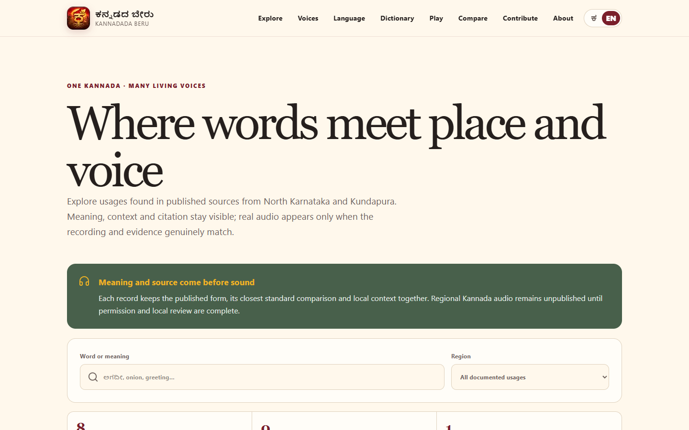
  </a>
</p>

<p align="center"><strong>Words meet place, evidence and voice in one focused journey.</strong></p>

## ⚡ See the whole story in 90 seconds

1. **[Open Many Living Voices](https://kannadada-beru.vercel.app/voices)** — hear 12 credited General Kannada words, explore five community voice prompts, and browse eight sourced regional usages.
2. **[Explore Karnataka](https://kannadada-beru.vercel.app/explore)** — select any of 31 districts for a bilingual introduction, history, places, culture, language context, and official links.
3. **[Search 156,650 dictionary entries](https://kannadada-beru.vercel.app/dictionary)** — browse by Kannada initial or search in Kannada, Romanized Kannada, and English.
4. **[Visit Karavali](https://kannadada-beru.vercel.app/regions/karaavali)** — learn how Kannada and Tulu share the coast, then hear a credited human Tulu recording of `ಕುಡ್ಲ`.
5. **[Compare regional context](https://kannadada-beru.vercel.app/compare)** — place two regions side by side without confusing vocabulary, geography, and pronunciation.
6. **[Share your regional voice](https://kannadada-beru.vercel.app/contribute/audio)** — choose a meaning, record naturally, set your attribution preference and send the clip securely.

## ✨ The experience at a glance

| **156,650** | **31** | **12** | **5** | **8** | **10** |
| ---: | ---: | ---: | ---: | ---: | ---: |
| dictionary entries | Karnataka districts | CC0 Kannada references | community voice prompts | documented usages | game rounds |

| Experience | What visitors can do |
| --- | --- |
| 🗺️ **Living atlas** | Explore every current Karnataka district through bilingual history, identity, landmarks, culture, and language context |
| 🔎 **Kannada dictionary** | Search 139,991 headwords and 247,674 English definitions without downloading the whole corpus |
| 🌊 **Regional stories** | Move through Bengaluru-Mysuru, Dharwad, Karavali, and Kalyana Karnataka; discover Tulu in its own linguistic context |
| 🎧 **Many Living Voices** | Filter sourced regional expressions by place or meaning; see the published form, standard comparison, locality, context and source together |
| 🔊 **Permission-led audio** | Hear 12 locally bundled CC0 General Kannada recordings, then contribute natural expressions from Mysuru, Dharwad and Kalaburagi |
| ↔️ **Thoughtful comparison** | Compare documented usage while keeping pronunciation, vocabulary, and regional identity meaningfully distinct |
| 🎮 **Pada Beru** | Learn through a bilingual, touch-friendly vocabulary game with scores, streaks, hints, and optional speech |
| 🤝 **Private contribution** | Record on a phone, choose a prompt and region, set attribution and permission, then upload securely to a private collection |
| 📱 **Installable PWA** | Use a responsive, HTTPS, offline-capable experience across phone and desktop |

<table>
  <tr>
    <td width="50%">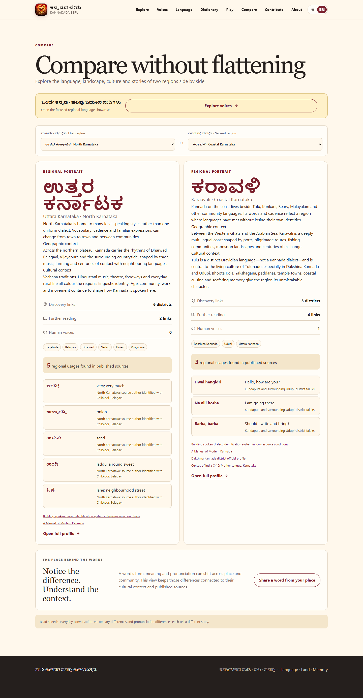</td>
    <td width="50%">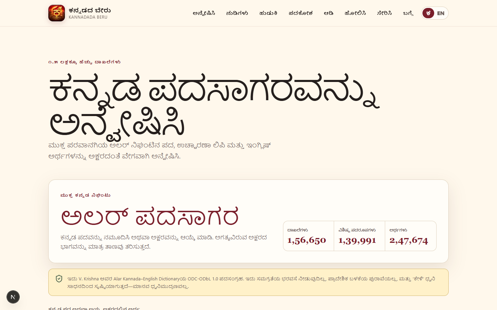</td>
  </tr>
  <tr>
    <td align="center"><strong>Regional context, side by side</strong></td>
    <td align="center"><strong>A large dictionary, loaded on demand</strong></td>
  </tr>
  <tr>
    <td width="50%">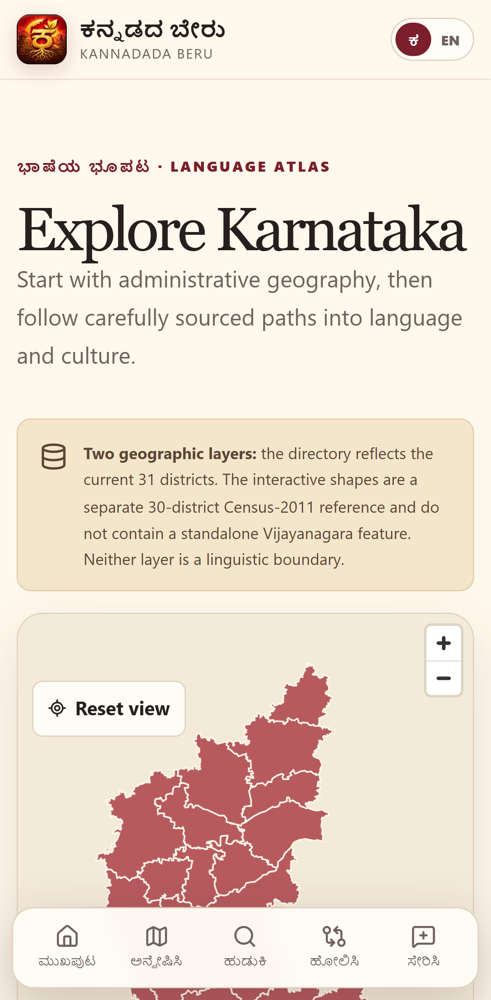</td>
    <td width="50%">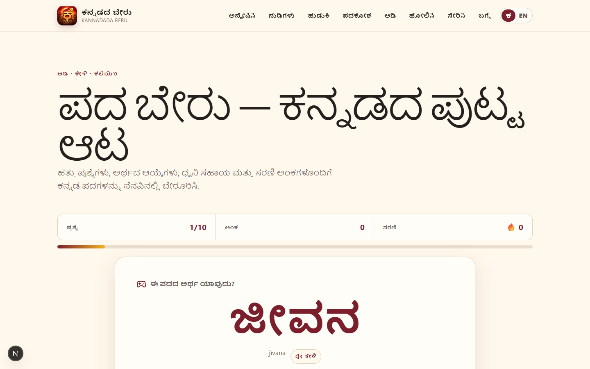</td>
  </tr>
  <tr>
    <td align="center"><strong>31 districts, made for mobile</strong></td>
    <td align="center"><strong>Language learning through play</strong></td>
  </tr>
</table>

## 🎙️ Community voices with clear provenance

The pronunciation explorer bundles 12 small CC0 Kannada recordings for reliable playback and offline use. Every clip retains its exact Commons source, speaker or uploader, date and licence. Because those source records do not publish speaker region, the app presents them as **General Kannada references**.

The regional collection uses five shared meanings across Mysuru, Dharwad and Kalaburagi. Speakers can record the expression natural to their region, supply the exact Kannada transcript, choose public credit or anonymity, and grant clear publication permission. Selected matching clips appear side by side in the comparison.

<p align="center">
  <a href="https://kannadada-beru.vercel.app/contribute/audio">
    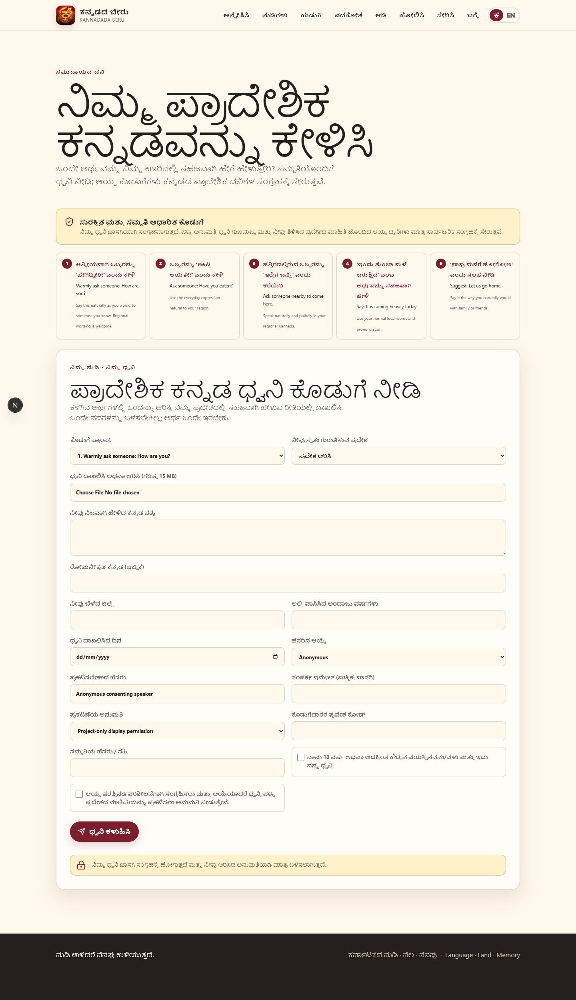
  </a>
</p>

<p align="center">
  <a href="https://kannadada-beru.vercel.app/regions/karaavali">
    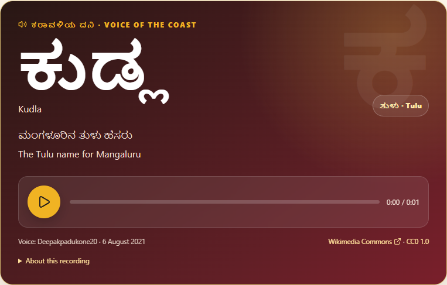
  </a>
</p>

The Karavali experience includes an authentic human recording of **ಕುಡ್ಲ** (*Kudla*, a familiar Tulu name for Mangaluru). The audio is published with the word, meaning, transcript, language, regional context, speaker attribution, original source, and CC0 reuse status visible together. It is clearly identified as Tulu and is not counted as regional Kannada audio. Device text-to-speech remains labelled elsewhere and is never presented as a regional human recording.

## 🏗️ How the product was made

The app began with a simple product question: **how can regional language knowledge feel inviting without losing its evidence, ownership, or context?** That led to six connected pieces of work:

1. **A Kannada-first interface** — responsive typography, navigation, search, and learning flows were designed around Kannada rather than translated as an afterthought.
2. **A lightweight language engine** — the open Alar dictionary was normalised into 50 alphabet shards so a 156K-entry resource remains quick on ordinary phones.
3. **A district and region story layer** — all 31 districts received concise Kannada and English narratives, while the regional pages connect language to history, landscape, and culture.
4. **A provenance-aware media model** — every published recording keeps its transcript, speaker region, attribution and permission together.
5. **A private contribution flow** — direct browser uploads send invited recordings to private storage while keeping contact details away from public pages.
6. **A production release pipeline** — data validation, unit tests, Android and desktop browser journeys, production builds and live HTTPS checks protect the finished experience.

## 🧭 Product architecture

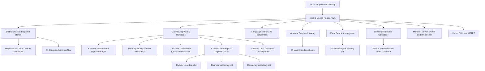

## 🔐 Data and permission architecture

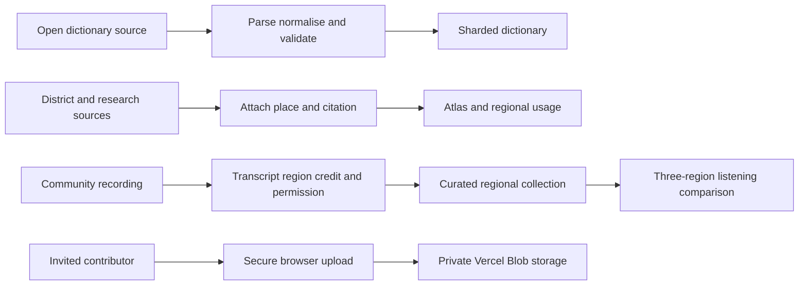

This separation is deliberate: a general dictionary definition is not automatically a regional claim, a place label is not proof of pronunciation, and synthetic or device speech is not an authentic community recording.

## 🚢 Quality and release flow

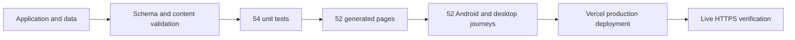

## 🧰 Technology map

| Layer | Technology | Why it is here |
| --- | --- | --- |
| Web foundation | Next.js 16.4 · React 19 · TypeScript 6 | Server-rendered routes, typed product logic, metadata, and fast navigation |
| Visual system | Custom responsive CSS · Lucide icons | A distinctive Kannada-first identity without a heavy UI framework |
| Geographic experience | MapLibre GL JS · local GeoJSON | Interactive maps with no paid map API or runtime token |
| Language data | Sharded JSON · Alar ODbL dataset | Large-vocabulary search with small, on-demand downloads |
| Validation | Zod · build-time data checks | Consistent records across districts, words, sources, and contributions |
| Voice contributions | Vercel Blob client uploads · private storage | Secure permission-led collection without exposing recordings publicly |
| Offline experience | Web app manifest · service worker | Installability, cached shell, update handling, and offline fallback |
| Verification | Vitest · Playwright | Domain contracts plus real Android-sized and desktop journeys |
| Delivery | Vercel · HTTPS · CDN | Fast public access and repeatable production deployment |

## 🗂️ Repository anatomy

```text
src/app/                 Route experiences, metadata, manifest and offline shell
src/components/          Navigation, atlas, dictionary, audio and interaction UI
src/lib/                 Search, validation, language data and storage contracts
public/data/alar/        50 generated dictionary shards and their index
public/data/             Regional records, geography and public source metadata
public/audio/kannada/    12 CC0 OGG files and checksum-backed provenance manifest
public/templates/        Speaker consent and regional recording intake form
data/                    Regional pilot and editorial review ledgers
e2e/                     Android-sized and desktop user-journey tests
scripts/                 Dataset preparation, checks and screenshot tooling
docs/                    Architecture, sources, research and product vision
public/showcase/         Product screenshots used by this README
```

## 🚀 Run it locally

Requirements: **Node.js 20.9+** and **pnpm 11**.

```powershell
pnpm install --frozen-lockfile
pnpm dev
```

Open `http://localhost:3000`. The atlas, dictionary, regional stories, game and bundled audio run locally. Private voice uploads use the configured Vercel Blob store.

### Verification

```powershell
pnpm check
pnpm test:e2e
$env:LIVE_BASE_URL='https://kannadada-beru.vercel.app'; pnpm test:e2e:live
pnpm audit --prod
```

Current release evidence:

- **54/54 unit tests** across 17 files
- **52 production browser journeys** across Android-sized and desktop Chrome, including installed-PWA offline reopening
- **52 generated pages** in the production build
- Live contribution, navigation and responsive-layout checks on the production URL
- Zero known production dependency vulnerabilities at release verification

## 📚 Data, attribution, and reuse

- **Dictionary:** derived from V. Krishna's *Alar Kannada–English Dictionary* under **ODC-ODbL 1.0**. The derived shards preserve attribution and share-alike obligations.
- **Geography:** historical Census-2011-vintage boundary data from the DataMeet community, presented as geographic context—not as proof of dialect boundaries.
- **Regional usage:** each public record carries its own source and context; it is not inferred from the general dictionary.
- **Human audio:** 12 General Kannada word recordings are bundled from Wikimedia Commons/Spell4Wiki under **CC0**, with checksums and source records; none carries a regional claim. The separate public `ಕುಡ್ಲ` Tulu recording is credited to **Deepakpadukone20** under **CC0**.
[Data sources](docs/DATA_SOURCES.md) · [Architecture](docs/ARCHITECTURE.md) · [Regional language research](docs/KANNADA_DIALECT_RESEARCH.md) · [Product vision](docs/PRODUCT_VISION.md) · [Third-party notices](THIRD_PARTY_NOTICES.md)

Original project source code is available under the [MIT License](LICENSE). Third-party datasets and media retain their own licences and attribution requirements.

## 🏆 Why this MVP stands out

- **Immediately useful:** no account, secret, paid API, or external database is needed for the core experience.
- **Built for real devices:** the large dictionary is sharded, the interface is touch-friendly, and the main journeys are exercised at Android and desktop sizes.
- **More than a map:** every district opens into history, language, culture, and places worth exploring.
- **A memorable centrepiece:** Many Living Voices turns regional-language evidence into a focused, searchable story rather than a loose list of words.
- **Kannada is foundational:** the product structure, search behaviour, typography, storytelling, and game were shaped around Kannada from the start.
- **Authenticity is visible:** 12 Kannada references are credited and integrity-checked without inventing speaker regions; new community recordings keep their transcript, region and permission together.
- **Privacy is understandable:** invited audio contributions go directly to private storage and public pages expose no contact details.
- **Coherent language model:** the app keeps general vocabulary, regional usage, and human audio meaningfully distinct.

## 📎 Project resources

- [Architecture](docs/ARCHITECTURE.md)
- [Data sources and attribution](docs/DATA_SOURCES.md)
- [Kannada regional language research](docs/KANNADA_DIALECT_RESEARCH.md)
- [Hackathon submission deck (PPTX)](Kannadada%20Beru%20Final%20Presentation/Kannadada_Beru_Submission_2026_RELEASE.pptx)
- [Hackathon submission deck (PDF)](Kannadada%20Beru%20Final%20Presentation/Kannadada_Beru_Submission_2026_RELEASE.pdf)
- [Product vision](docs/PRODUCT_VISION.md)
- [Third-party notices](THIRD_PARTY_NOTICES.md)

## ❤️ Why this matters

> Kannada is more than a language we inherit—it is a living memory carried in the words of our homes, towns, coastlines, fields, classrooms, and everyday conversations. Kannadada Beru is an attempt to honour that richness: not by flattening every voice into one version, but by preserving the place, people, meaning, and permission around each expression.
>
> ಕನ್ನಡವು ನಮಗೆ ಬಂದಿರುವ ಭಾಷೆಯಷ್ಟೇ ಅಲ್ಲ—ಅದು ನಮ್ಮ ಮನೆಗಳ, ಊರುಗಳ, ಕರಾವಳಿಯ, ಹೊಲಗಳ, ತರಗತಿಗಳ ಮತ್ತು ದಿನನಿತ್ಯದ ಮಾತುಕತೆಗಳ ಜೀವಂತ ನೆನಪು. ಪ್ರತಿಯೊಂದು ನುಡಿಯನ್ನೂ ಒಂದೇ ರೂಪಕ್ಕೆ ಒತ್ತಿಹಾಕದೆ, ಅದರ ಸ್ಥಳ, ಜನ, ಅರ್ಥ ಮತ್ತು ಅನುಮತಿಯನ್ನು ಗೌರವದಿಂದ ಉಳಿಸುವುದೇ ಕನ್ನಡದ ಬೇರು ಯೋಜನೆಯ ಉದ್ದೇಶ.

<div align="center">

### ನಮ್ಮ ನುಡಿ · ನಮ್ಮ ಬೇರು · ನಮ್ಮ ಹೆಮ್ಮೆ

**Made with care in Karnataka, for every story that lives between its words.**

[Live app](https://kannadada-beru.vercel.app) · [Architecture](docs/ARCHITECTURE.md) · [MIT licence](LICENSE)

</div>
