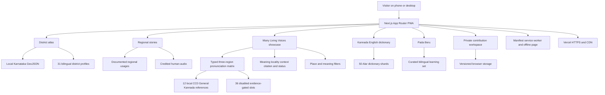
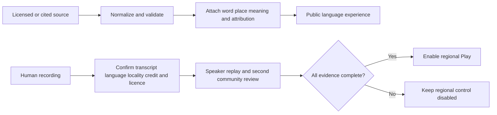

# Kannadada Beru Architecture

Kannadada Beru is a static-first Next.js application designed to stay fast on ordinary phones. Its public experience needs no account, secret key, paid map service, or external database.

## Product structure

## Application layers

1. **Routes and presentation** provide the home page, Many Living Voices showcase, atlas, district profiles, region profiles, dictionary, comparison, game, contribution workspace, and About story.
2. **Validated content** keeps district profiles, regional usage, audio attribution, and language records consistent before they reach the interface.
3. **On-demand language data** divides the Alar dictionary into 50 Kannada-initial shards. The browser downloads only the section a visitor opens.
4. **Local geography** lets MapLibre render the Karnataka district layer without a paid map token or third-party tracking request.
5. **Private browser storage** holds contribution drafts on the visitor's device and exports them only after an explicit action.
6. **Offline support** caches the public shell, the 12 approved General Kannada OGG files and previously opened static resources while keeping update handling predictable.

## Language and audio flow

The model keeps general dictionary definitions, regional usage, General Kannada pronunciation and region-verified pronunciation as separate evidence types. Each of the 12 General Kannada records has a local audio path and public provenance but an explicit `regionClaim: none`. Each Mysuru, Dharwad and Kalaburagi slot is `recording_needed` until its own audio, transcript, origin metadata, consent, rights and human reviews are complete. The public `ಕುಡ್ಲ` recording remains a separate Tulu example and is not counted as regional Kannada audio.

## Accessibility and resilience

The interface uses semantic landmarks, visible focus states, large touch targets, reduced-motion support, Kannada-aware font fallbacks, and card navigation alongside the interactive map. Every core route has a static production representation, and the PWA provides a dedicated offline page.

## Release verification

The release pipeline runs lint rules, strict TypeScript checks, unit tests, a full production build, and browser journeys across Android-sized and desktop Chrome. Release evidence records the exact counts produced by the final run.
